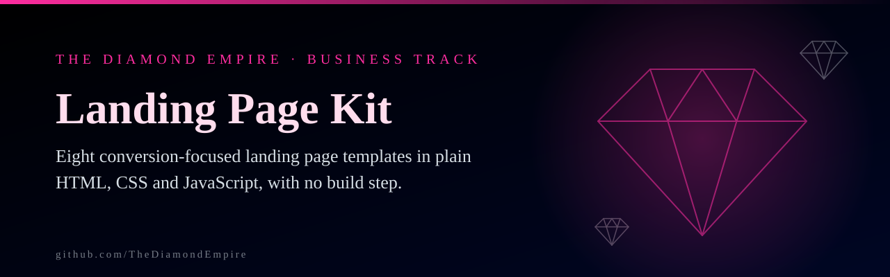
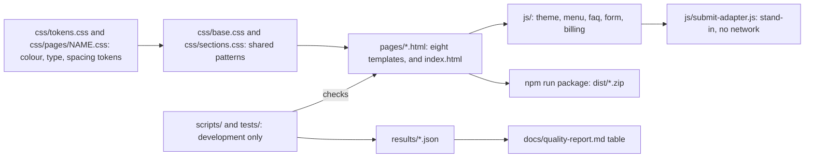

<p align="center"></p>

<p align="center">
  
  
  
</p>

# Landing Page Kit

> Eight conversion-focused landing page templates in plain HTML, CSS and JavaScript, with no build step.

Eight complete landing pages (SaaS, mobile app, product launch, event, waitlist, webinar, agency and pricing) built in plain HTML, CSS and a little vanilla JavaScript. No framework and no build step: open the file, edit the text and publish anywhere.

**Quick links:** [Architecture](#architecture) · [Tech stack](#tech-stack) · [Engineering decisions](#engineering-decisions) · [Quality report](docs/quality-report.md) · [Roadmap](#roadmap) · [Case study](docs/case-study.md)

> **Public showcase.** This repository holds the documentation, client case study, research report and measured results for this product. The runnable source code is distributed separately under a license: see [SOURCE-ACCESS.md](SOURCE-ACCESS.md).

## At a glance

|  |  |
|---|---|
| **Track** | Business · Advanced |
| **Phase** | Beta: all five milestones work, the tests pass from a clean short-path copy, and [docs/quality-report.md](docs/quality-report.md) records the results. Not Live: no customer has used it and no real form provider has been connected. |
| **Primary reader** | Clients and founders |
| **Read next** | [Quality report](docs/quality-report.md) · [Client case study](docs/case-study.md) |

## Why this exists

Marketers and small teams need a landing page this week. Page builders are slow and heavy, and frameworks are overkill for a single page.

## What it does (built and tested)

- **Eight visually distinct pages** in `pages/`: SaaS, mobile app, product launch, event, waitlist, webinar, agency and pricing, plus a gallery page (`index.html`). Each has its own palette, type, layout and original SVG artwork; all content is sample content.
- **Shared, documented section patterns**: header and navigation, hero, proof (logo strip), features, steps, quotes, pricing, FAQ, form, footer ([guide](docs/guide/03-section-patterns.md) is in the customer package).
- **Plain files**: HTML5, modern CSS (custom properties, grid, `clamp()` fluid type and spacing) and small classic scripts with no dependencies. The pages open from the file system and work on any static host.
- **Responsive from 320 px to wide screens**, with no horizontal scroll at 320, 768 and 1280 px (tested).
- **Light theme and dark theme from the same tokens**: automatic through `prefers-color-scheme`, plus a toggle button that remembers the choice on the device.
- **Email form**: client-side validation with accessible error messages and a status region; a provider-neutral submit adapter (`js/submit-adapter.js`, one function, `window.lpkSubmit`). The included version is a stand-in that makes no network request and shows a message marked "Demo". Provider examples are in the adapter comment and in the connect-a-form guide.
- **Accessibility work that is tested**: landmarks, skip link, keyboard operation of every control with a visible focus ring, reduced motion respected, colour contrast computed from the tokens in both themes. Automated tests find only part of the problems that affect people, so this is **not** a claim of conformance with any accessibility standard; see the [quality report](docs/quality-report.md) for what was tested and what was not.
- **No tracking**: no analytics, no third-party requests, no web fonts, no CDN. Analytics are an opt-in snippet in the guides only and are never active.
- **Weight budgets enforced by tests**, no third-party requests, valid HTML, and every link and anchor resolving.
- **`npm run package`** builds the customer ZIP (pages, css, js, assets, guides) into `dist/`, which is tested by extracting it and opening the pages from the file system.

## Architecture



## Tech stack

| Layer | Technology used |
|---|---|
| Markup and styles | HTML5; modern CSS: custom properties, grid, flexbox, `clamp()`, `prefers-color-scheme`, `prefers-reduced-motion` (no container queries were needed) |
| Behaviour | Vanilla JavaScript, classic deferred scripts wrapped in functions, no dependencies, no build step |
| Artwork | Original hand-written SVG; system font stacks; no raster images |
| Testing | Node's built-in test runner (`node --test`); `html-validate` 11.17.0; `axe-core` 4.14.0 in the installed Chrome driven by `playwright-core` 1.64.1; a contrast script; byte, request, link, anchor, third-party and tracking scans |
| Packaging | `adm-zip` 0.6.1 builds a deterministic ZIP |
| Delivery | Static files; a GitHub Actions workflow that runs the same commands (never run, see below) |

## Engineering decisions

### No build step

Buyers can edit and ship with a text editor. The price is some repeated markup across pages, mitigated by documented section patterns.

### Classic scripts, not ES modules

The kit must work when a page is opened from the file system. In the Chrome used here, `<script type="module">` is blocked on `file://` pages (the check is recorded in `results/package.json`), so each script is a small classic script in a function, loaded with `defer`. The only global is `window.lpkSubmit`.

### Weight is a feature

Each page has a byte budget, a gzip budget and a request budget in `tests/budgets.json`, fixed before the pages were written and enforced by tests.

### No hidden tracking

The kit ships with no analytics or third-party requests, so privacy is the default and measurement is an explicit choice. A test fails if a tracker or an outside URL appears.

### Tokens, with the dark values written twice

Every colour is a token. CSS has no way to share one block between `@media (prefers-color-scheme: dark)` and `[data-theme="dark"]`, so the dark values appear twice; a test fails if the two copies differ.

### Honest forms

The default adapter is a stand-in that says so on screen. It cannot be mistaken for a working sign-up form.

## Quality bar

Everything below is enforced by `npm test` and recorded in the [quality report](docs/quality-report.md):

- Valid HTML on all pages (html-validate, recommended preset, no rule disabled)
- Zero axe-core violations on every page in the tested variants: light and dark theme at 320, 768 and 1280 px wide, a forced theme, the form error state and the open mobile menu (axe covers only part of what matters for accessibility)
- Per-page weight, gzip and request budgets, and no third-party requests
- All internal links and in-page anchors resolve

## Not built yet / out of scope

- **A real form provider connection.** The adapter ships as a stand-in on purpose; connecting one depends on the customer's provider. Examples are documented, none was tested against a live service.
- **Screen reader, Firefox, Safari and real-device testing.** Only the installed Chrome was used (see the quality report).
- **Container queries.** Not needed by any layout, so none are used.
- **Open Graph images, canonical links and `og:url`.** They need the customer's final absolute URLs, so the checklist in the guides tells the customer to add them.
- **Multiple languages and right-to-left layouts.**
- **A CMS, a build pipeline, a component framework or a page editor.** Out of scope by design.
- **Client results.** `docs/case-study.md` keeps its Results table blank: it is for measured engagements, and none has happened.
- **The GitHub Actions workflow has not been run.** It runs the same commands as local development, but this repository was built and verified locally only.

## Roadmap

- [x] M1: shared section library and design tokens
- [x] M2: SaaS, app and product-launch templates
- [x] M3: event, waitlist and webinar templates
- [x] M4: agency and pricing templates, form adapter
- [x] M5: accessibility, validity and weight tests, documentation

## Getting started

> _These instructions refer to the source package, which is distributed separately and is not part of this showcase repository._

Requirements: Node 22 or later, and Google Chrome or Microsoft Edge installed (the browser checks use the installed browser; nothing is downloaded).

To use the templates you only need the files: open `index.html` in a browser. To work on the kit and run the checks, from a clean checkout:

```text
npm ci
npm test
npm run measure
npm run package
```

`npm test` runs the static and browser tests (several minutes). `npm run measure` runs every measurement once and writes `results/*.json`. `npm run package` writes `dist/landing-page-kit-0.1.0.zip` for customers. `npm run serve` serves the folder on `http://127.0.0.1` if you prefer a server to opening files.

## Verification

> _These instructions refer to the source package, which is distributed separately and is not part of this showcase repository._

| Command | What it checks |
|---|---|
| `npm run test:static` | structure, JavaScript syntax, HTML validity, weight budgets, links, third-party and tracking scans, contrast from tokens, paths and author rule, THIRD-PARTY.md, README and report consistency |
| `npm run test:browser` | page facts, console and requests, forms, keyboard and focus, menu and theme, reduced motion, axe-core matrix, ZIP build and file:// loading |
| `npm test` | both of the above |
| `npm run measure` | all measurements once, raw output in `results/` |
| `npm run report:table` | regenerates the results table in `docs/quality-report.md` from `results/` |
| `npm run test:record` | runs the whole suite once and records the counts in `results/test-run.json` |
| `npm run contrast`, `npm run licenses`, `npm run check:paths` | single checks on their own |

The final verification was run from a clean copy at a short path (`npm ci`, then the commands above) with its outputs written outside the copy; see the [quality report](docs/quality-report.md) for results and limits.

## Repository layout

> _These instructions refer to the source package, which is distributed separately and is not part of this showcase repository._

```text
index.html            gallery of the eight templates
START-HERE.md         first page of the customer package
pages/                the eight landing pages
css/                  tokens.css, base.css, sections.css and pages/ (one file per page)
js/                   theme, menu, faq, form, billing and the submit adapter
assets/               original SVG artwork and favicon
docs/guide/           customer guides (in the ZIP)
docs/quality-report.md  what was measured and what it means
docs/case-study.md    client case study (results table intentionally blank)
results/              raw measurement output and the generated summary
scripts/              measure, package, contrast, licence and report scripts
tests/                tests and tests/budgets.json
THIRD-PARTY.md        what is bundled (nothing) and which dev tools are used
.github/workflows/ci.yml  CI definition (never run)
```

## Skills demonstrated

`HTML and CSS craft` · `Accessible design` · `Performance budgeting` · `Conversion-focused layout` · `Vanilla JavaScript` · `Static-site delivery`

## One project, three lenses

The same project is documented for three audiences, so one body of work serves every goal.

| If you are… | Read | You will find |
|---|---|---|
| Hiring or reviewing engineers | [This README](README.md) | Architecture, trade-offs, quality bar and what I would defend in a design review |
| A client or founder | [Client case study](docs/case-study.md) | The business problem, the value levers, how it is measured and how an engagement runs |
| A researcher or technical reviewer | Not applicable | This project is judged on its case study and its tests rather than an experimental study |

## Author

Built by **[The Diamond Empire](https://thedempire.shop/)**.
