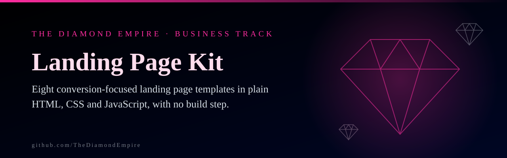

# Landing Page Kit: Client Case Study

> A fast, accessible landing page live in hours, with no lock-in.

> **Status of this document.** This is a reference case study: it sets out the business problem, the solution and the value model. The results table is intentionally blank and is filled in only from measured data (a pilot or a real engagement). No outcome figures are claimed here.

## Snapshot

|  |  |
|---|---|
| **Who it is for** | Marketers, founders and small teams who need a landing page quickly and want to own the code. |
| **Solution** | Eight conversion-focused landing page templates in plain HTML, CSS and JavaScript, with no build step. |
| **Track** | Business · Advanced |
| **Delivered by** | The Diamond Empire |

## The challenge

Landing pages take too long to build or are locked inside a builder. Heavy pages convert worse and cost more in ad spend.

## The solution

Eight complete landing pages (SaaS, mobile app, product launch, event, waitlist, webinar, agency and pricing) built in plain HTML, CSS and a little vanilla JavaScript. No framework and no build step: open the file, edit the text and publish anywhere.

What the client gets in practice:

- Eight distinct landing page layouts with shared, documented sections (hero, features, proof, pricing, FAQ, form, footer)
- Pure HTML, CSS and vanilla JavaScript; works from the file system and any static host
- Responsive from small phones to wide screens, with fluid type and spacing
- Accessible: semantic markup, keyboard support, visible focus, sufficient contrast checked, reduced-motion respected
- Email-capture form with validation and a provider-neutral submit adapter (a stand-in is included)

## How it creates value

| Value lever | How the solution delivers it | How we measure it |
|---|---|---|
| Time to publish | Ready-made, tested layouts | Hours from start to live page |
| Conversion | Fast pages with a clear structure and an easy form | Form conversion rate; bounce rate |
| Ad efficiency | Light pages load quickly on mobile | Cost per lead |
| Ownership | Plain files, no vendor lock-in | Cost of switching providers |

## How an engagement runs

| Phase | What happens |
|---|---|
| Pick | Choose a layout and write the copy |
| Brand | Colors, type and imagery |
| Connect | Form and analytics (opt-in) |
| Publish | Checks and go-live |

## What the client receives

- Chosen template rebranded and published
- Form connected to the client’s email tool
- Accessibility and weight check report
- Short editing guide

## Results

Baseline measurements are taken **before** the solution goes live, and the same measures are taken after, so every change in the table is attributable and honest.

| Measure | How measured | Baseline | After | Change |
|---|---|---|---|---|
| Time to publish | Hours from start to live page | — | — | — |
| Conversion | Form conversion rate; bounce rate | — | — | — |
| Ad efficiency | Cost per lead | — | — | — |
| Ownership | Cost of switching providers | — | — | — |

> **To fill in:** replace each — with measured values and add the measurement window and sample size beneath the table.

## How quality and risk are managed

- Valid HTML on all eight pages (html-validate)
- Zero axe-core violations on all eight pages (partial WCAG coverage, stated plainly)
- Per-page weight and request-count budgets enforced, with no third-party requests
- All internal links and in-page anchors resolve

## Is this a fit?

Best suited to: marketers, founders and small teams who need a landing page quickly and want to own the code.

## Talk to me

Want this adapted to your business? Get in touch via **[thedempire.shop](https://thedempire.shop/)**.

---

[README](../README.md) · [Client case study](case-study.md)
